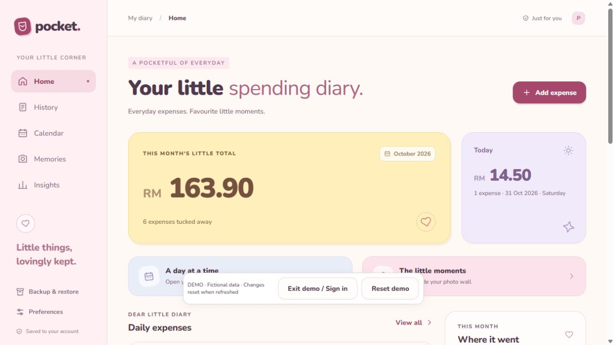
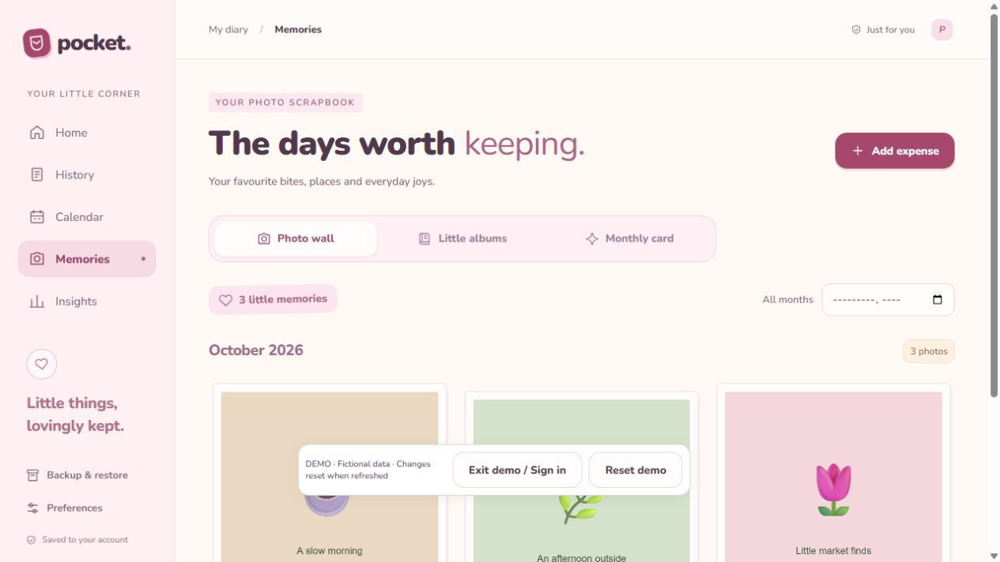

# Pocket

A mobile-first expense tracker in Malaysian ringgit with account-based cloud sync and private photo storage.

Live app: https://pocket-expense-tracker-drab.vercel.app/

Try the interactive demo without signing up: https://pocket-expense-tracker-drab.vercel.app/?demo=1

The demo includes fictional expenses, illustrated JPEG keepsakes and an album. Explore all views, add or edit entries, and export backups. Changes stay in this tab's memory and reset on refresh. Demo actions never save to an account or Supabase.





## Privacy model

- Email/password authentication is provided by Supabase Auth. Email confirmation is required.
- Every diary row is owned by `auth.uid()` and protected by PostgreSQL Row Level Security.
- Photos are stored in a private Supabase Storage bucket under the authenticated user's UUID.
- Users cannot read, update, delete, or upload into another account's diary or photo directory.
- The browser receives only the Supabase publishable key. Privileged database keys and SMTP credentials are not stored in this repository.
- Concurrent saves use a revision check so stale tabs cannot silently overwrite newer data.

The GitHub repository and application login page are public. Expense records and photos are not public.

## Features

- Daily expense diary with MYR totals, search, category filters, calendar and insights
- Optional private photo attachments, cover photos and individual photo captions
- Photo memories, themed albums and monthly keepsake cards
- CSV export and versioned complete JSON backup/restore
- Responsive desktop and mobile layouts

## Run locally

Requires Node.js 20 or later.

```sh
npm install
npm run dev
```

Open http://localhost:3000. The checked-in client is configured for the hosted Supabase project; use your own Supabase project and apply `database/schema.sql` before operating a separate deployment.

Run all build, syntax and unit checks with:

```sh
npm run check
```

## Architecture

- `dist/auth-entry.js`: sign-up, email verification, login, logout and owner-only legacy import entry point
- `dist/session.js`: verified-session guard and account-switch invalidation
- `dist/cloud.js`: authenticated diary persistence, private photo upload/download and integrity verification
- `database/schema.sql`: diary schema, save RPC, private bucket and RLS policies
- `dist/app.js`: views, dialogs, navigation and account-lock cleanup
- `dist/data.js`: validation, date formatting, filtering, calculations and CSV export
- `dist/storage.js`: legacy IndexedDB adapter used for owner migration and local backup compatibility
- `dist/photos.js`: local image validation, resizing and metadata-stripping re-encoding
- `dist/backup.js`: complete backup serialization and strict restore validation
- `tests/`: calculations, backup compatibility, session invalidation and UI data-model tests

## Storage and migration

New accounts start with an empty diary. Expenses, categories and albums are stored as a versioned JSON document in `public.pocket_diaries`; photos are separate private objects and are referenced only from their owner's document.

The original owner's legacy browser data can be imported only by the server-configured owner account and only into an empty cloud diary. The import creates a complete local backup first, uploads the cloud copy, downloads it again and compares the result before reporting success. The original IndexedDB data is left intact.

Complete backups are ordinary unencrypted JSON files. Store exported backups somewhere you trust.

## Verification

`npm run check` currently runs 18 automated tests. Release verification also covers:

- two confirmed accounts signing in independently;
- bidirectional denial of cross-account diary reads and updates;
- bidirectional denial of cross-account photo downloads and forged uploads;
- stale revision rejection without automatic transaction retry loops;
- logout and same-account relogin invalidating pending responses;
- browser add, logout, account switch and re-login flows;
- 390px mobile layout without horizontal overflow;
- anonymous diary access and public photo URLs remaining denied.

## Deployment

Vercel builds with `npm run check` and publishes `dist`. The production login page is public; application data access is enforced by Supabase Auth, RLS and private Storage policies.

